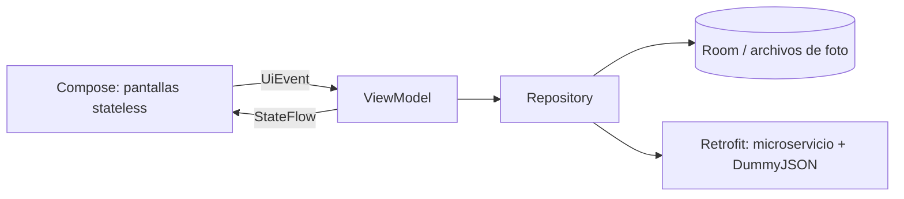
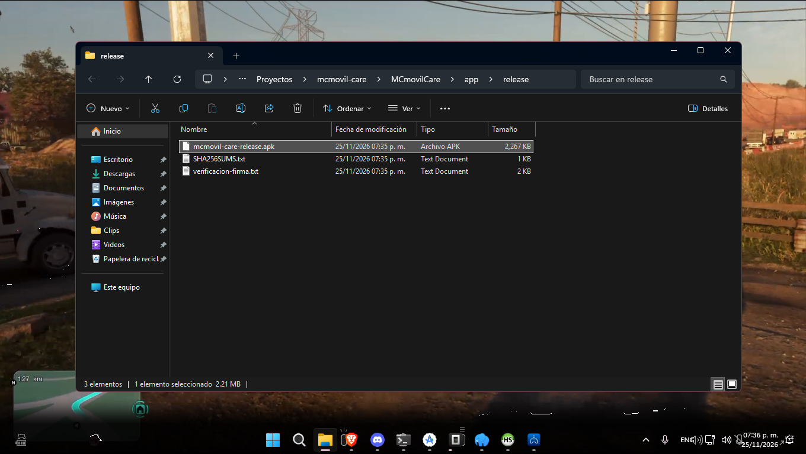
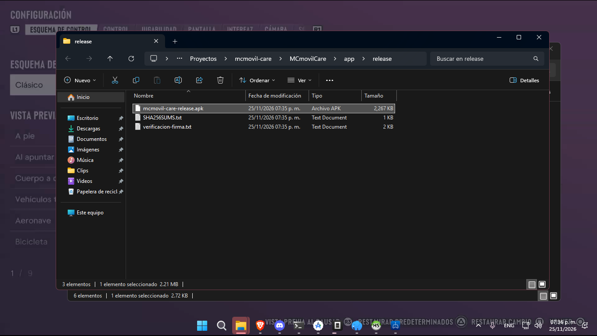

# Documentación técnica — MCmovil Care (EV4)

Este archivo conserva el detalle técnico de la entrega. El `README.md` es el resumen corto.

## Contexto

Aplicación móvil académica para un servicio técnico: consulta de equipos, registro de solicitudes, seguimiento de atenciones y decisiones sobre cotizaciones. La información del taller se obtiene en tiempo real del microservicio Spring Boot propio. La API externa DummyJSON se usa solo como catálogo de referencia electrónica en el detalle del equipo; no sustituye ni representa los equipos reales del taller.

## Integrantes

| Integrante | Correo | Rol principal en EV4 |
| --- | --- | --- |
| Matías Muñoz | matias.munoz.c05@gmail.com | App Android, integración Retrofit, firma y APK |
| Moisés Pontigo | moisespontigo25@gmail.com | Microservicio, base de datos, pruebas unitarias y cobertura |

## Tecnologías

- Kotlin + Jetpack Compose + Material 3
- Arquitectura MVVM: `model/`, `repository/`, `ui/`, `viewmodel/` y `MainActivity.kt` en la raíz del paquete
- Room para solicitudes y decisiones locales
- Retrofit 3.0.0 + OkHttp 4.12.0 + Gson para el microservicio y DummyJSON
- Coil 2.7.0 para la imagen de referencia externa
- Spring Boot 3.5.3 + Java 21 + Gradle 8.14.8
- MySQL 8.4.3 (Laragon), base de datos `mcmovil_care`
- JUnit + MockK + Mockito + JaCoCo 0.8.13

## Funcionalidades

### Aplicación

- Listado de equipos y atenciones obtenidos desde el microservicio, con respaldo local de 3 equipos y 6 atenciones si el servicio no responde.
- Detalle de equipo con marca, modelo y estado; muestra además un producto electrónico de referencia de DummyJSON, identificado como dato externo y no como parte del taller.
- Formulario de solicitud de atención con la validación original de la app (descripción de al menos 10 caracteres).
- Cámara con permiso `CAMERA` solicitado en tiempo de ejecución y mensaje claro si se rechaza.
- Galería con permiso de imágenes solicitado en tiempo de ejecución (`READ_MEDIA_IMAGES` en API 33+ y `READ_EXTERNAL_STORAGE` en API 32 o inferior).
- Fotos capturadas o seleccionadas guardadas en almacenamiento interno; su ruta se persiste en Room, por lo que sobreviven al cierre de la app.
- Solicitudes sincronizadas entre el microservicio y Room.
- Detalle de atención con diagnóstico plegable, cotización, aceptación/rechazo y evidencia fotográfica desde galería.
- Decisiones sincronizadas entre el microservicio y Room.
- Navegación Compose y pantallas stateless: la UI observa `StateFlow` y envía eventos al ViewModel.

### Flujo MVVM



### Esquema local (Room, versión 2)

| Tabla | Columnas | Uso |
| --- | --- | --- |
| `solicitudes` | `id`, `equipoId`, `descripcion`, `estado`, `fotoRuta` | Solicitudes y ruta de la foto adjunta |
| `decisiones_cotizacion` | `atencionId`, `decision`, `evidenciaRuta` | Decisión local y ruta de la evidencia |

La migración `1 → 2` agrega `fotoRuta` y `evidenciaRuta` sin borrar los datos existentes.

### Microservicio

- CRUD de equipos, atenciones y solicitudes.
- Consulta por equipo para atenciones y solicitudes.
- Lectura y actualización de la decisión de cotización por atención.
- Validaciones y respuestas `200`, `201`, `204`, `400` y `404`.
- Datos iniciales de 3 equipos y 6 atenciones cargados desde `data.sql`; las atenciones `1005` y `1006` incluyen decisiones de ejemplo `ACEPTADA` y `RECHAZADA`.

## Endpoints utilizados

### Microservicio propio

Base configurable en `MCmovilCare/gradle.properties` mediante `backendUrl`. Valor incluido: `https://dwindle-squishier-fetch.ngrok-free.dev/api/`, un dominio público fijo de ngrok que permite usar el celular con cualquier internet sin depender de la Wi‑Fi de la PC ni de escribir una IP. Desde la PC se verifica con `http://localhost:8080/api`. Se genera en `BuildConfig.BACKEND_URL` y lo consume `ApiClient.kt`, que envía el header `Ngrok-Skip-Browser-Warning: 1` para evitar la página de advertencia del plan gratis.

| Método | Ruta | Uso en la app |
| --- | --- | --- |
| `GET` | `/equipos` | Listado de equipos |
| `GET` | `/equipos/{id}` | Detalle de equipo |
| `POST` | `/equipos` | Alta de equipos |
| `PUT` | `/equipos/{id}` | Actualización de equipos |
| `DELETE` | `/equipos/{id}` | Baja de equipos |
| `GET` | `/atenciones` | Listado de atenciones |
| `GET` | `/atenciones/{id}` | Detalle de atención |
| `GET` | `/atenciones/equipo/{equipoId}` | Atenciones filtradas por equipo |
| `POST` | `/atenciones` | Alta de atenciones |
| `PUT` | `/atenciones/{id}` | Actualización de atenciones |
| `DELETE` | `/atenciones/{id}` | Baja de atenciones |
| `GET` | `/solicitudes` | Sincronización de solicitudes con Room |
| `GET` | `/solicitudes/{id}` | Detalle de solicitud |
| `GET` | `/solicitudes/equipo/{equipoId}` | Solicitudes filtradas por equipo |
| `POST` | `/solicitudes` | Registro de solicitudes desde el formulario |
| `PUT` | `/solicitudes/{id}` | Actualización de solicitudes |
| `DELETE` | `/solicitudes/{id}` | Baja de solicitudes |
| `GET` | `/atenciones/{id}/decision` | Sincronización de la decisión |
| `PUT` | `/atenciones/{id}/decision` | Aceptar/rechazar cotización |

Cuerpos JSON:

```json
{ "id": 1, "nombre": "Notebook personal", "marca": "Lenovo", "modelo": "IdeaPad 3", "estado": "En diagnóstico" }
{ "id": 1001, "equipoId": 1, "estado": "En diagnóstico", "diagnostico": "Posible falla de almacenamiento", "cotizacion": 45000 }
{ "id": 5, "equipoId": 1, "descripcion": "Revisión del equipo completo", "estado": "Pendiente" }
{ "decision": "PENDIENTE|ACEPTADA|RECHAZADA" }
```

### API externa

| Método | Ruta | Dato mostrado |
| --- | --- | --- |
| `GET` | `https://dummyjson.com/products/81` | Lenovo Yoga 920: referencia para el equipo 1 |
| `GET` | `https://dummyjson.com/products/132` | Samsung Galaxy S8: referencia para el equipo 2 |
| `GET` | `https://dummyjson.com/products/160` | Samsung Galaxy Tab S8 Plus: referencia para el equipo 3 |

La app muestra título, marca, precio e imagen en una tarjeta separada y etiquetada como “Referencia externa (catálogo)”. La API externa no es la fuente de “Mis equipos” ni de “Mis atenciones”: esos datos vienen del microservicio propio. No requiere API key y no interfiere con Room.

## Pasos para ejecutar

### 1. Base de datos

Con MySQL de Laragon en `127.0.0.1:3306`, usuario `root` sin contraseña:

```powershell
mysql -h localhost -P 3306 -u root -e "CREATE DATABASE IF NOT EXISTS mcmovil_care CHARACTER SET utf8mb4 COLLATE utf8mb4_unicode_ci;"
```

### 2. Microservicio

```powershell
cd backend\mcmovil-api
.\gradlew.bat bootRun
```

Verificación rápida:

```powershell
curl http://localhost:8080/api/equipos
```

### Túnel público (ngrok)

Con la cuenta ya autenticada, ejecutar en otra terminal:

```powershell
& 'C:\Users\moise\AppData\Local\Microsoft\WinGet\Packages\Ngrok.Ngrok_Microsoft.Winget.Source_8wekyb3d8bbwe\ngrok.exe' http 8080
```

El agente reutiliza el dominio fijo `https://dwindle-squishier-fetch.ngrok-free.dev`. Si la versión instalada es antigua, actualizar primero con `ngrok update`. Verificación desde cualquier red:

```powershell
Invoke-RestMethod -Uri 'https://dwindle-squishier-fetch.ngrok-free.dev/api/atenciones' -Headers @{ 'Ngrok-Skip-Browser-Warning' = '1' }
```

### 3. Aplicación Android

1. Clonar `https://github.com/Skeeeeewb/mcmovil-care.git`.
2. Abrir la carpeta `MCmovilCare` con Android Studio y sincronizar Gradle.
3. Ejecutar la configuración `app` en un emulador con API 26 o superior o instalar el APK firmado en el celular (`adb install -r MCmovilCare/app/release/mcmovil-care-release.apk`).
4. Para usar el celular con datos móviles o en otra Wi‑Fi, dejar el `backendUrl` de ngrok incluido en el APK. En la PC iniciar MySQL, el microservicio y `ngrok http 8080`; el túnel reutiliza el dominio fijo de la cuenta. Si ngrok o el backend no están disponibles, la app sigue funcionando con los datos de respaldo y Room.
5. Al abrir cámara o galería, aceptar el permiso solicitado. Si se rechaza, la pantalla muestra un mensaje y no se cierra.

### 4. Pruebas y cobertura

```powershell
cd backend\mcmovil-api
.\gradlew.bat test jacocoTestReport
```

```powershell
cd MCmovilCare
.\gradlew.bat :app:testDebugUnitTest :app:jacocoTestReport
```

Resultados verificados: 14 pruebas del backend y 52 pruebas de la app. La cobertura de la lógica Android (ViewModels, repositorios y mappers) es de **80,8%** de instrucciones, medida por JaCoCo; la cobertura del backend es de **47,9%**. El informe HTML queda en `MCmovilCare/app/build/reports/jacoco/jacocoTestReport/html/index.html`.

## APK firmado y keystore

| Archivo | Descripción |
| --- | --- |
| `MCmovilCare/app/mcmovil-care.jks` | Keystore PKCS12 usado para firmar |
| `MCmovilCare/app/release/mcmovil-care-release.apk` | APK firmado incluido en el repositorio |
| `MCmovilCare/app/release/SHA256SUMS.txt` | Hash SHA-256 del APK |
| `MCmovilCare/app/release/verificacion-firma.txt` | Salida de `apksigner verify --verbose --print-certs` |

Datos de firma acordados como valores de ejemplo:

- Alias: `mcmovilcare`
- Contraseña del store y de la clave: `mcmovil2026`
- Validez: 9.125 días (25 años)
- Algoritmo: RSA 2048, SHA256withRSA
- Certificado: `CN=MCmovil Care, OU=DSY1105, O=Duoc UC, L=Santiago, ST=Region Metropolitana, C=CL`
- Huella SHA-256 del certificado: `7f7a779c7df7d659e07222bf30ee5c9e4fd05038f38ba54634a329fcec6d5ac0`
- Firma verificada con el esquema APK Signature Scheme v2
- Hash SHA-256 del APK actual: `303b7c3efebb98357fd1ac8ad35fc64c14191231e1c6d011b2c428866c29a20c`
- El APK incluye compilada la URL pública de ngrok, por lo que el celular no necesita estar en la misma Wi‑Fi de la PC ni escribir una IP.
- El `packageScope` de R8 excluye `kotlin.**` para no reempaquetar clases internas de Kotlin.
- `app/proguard-rules.pro` conserva los constructores `(Application)` de `DetalleAtencionViewModel` y `SolicitudViewModel`, que Compose crea por reflexión; sin esta regla el release cerraba la app al abrir “Mis atenciones” o “Solicitar atención”.
- El release regenerado se instaló y verificó en emulador API 37: abre el detalle de atención, el detalle de equipo con referencia externa electrónica y el formulario de solicitud, sin `FATAL EXCEPTION`.

Capturas de evidencia:

| APK firmado | Keystore `.jks` |
| --- | --- |
|  |  |

Reconstrucción:

```powershell
cd MCmovilCare
.\gradlew.bat :app:assembleRelease
```

## Control de versiones y planificación

Ramas de trabajo conservadas: `matias/equipos`, `moises/seguimiento-atenciones`, `integracion/ev2`, `integracion/ev3` e `integracion/ev4`. Los commits de esta entrega están en `integracion/ev4` e incluyen trabajos de ambos integrantes, con mensajes en español y compilación verificada antes de cada commit.

Para revisar la autoría:

```powershell
git log integracion/ev4 --format='%h %an <%ae> %aI | %s' --author='Matías Muñoz'
git log integracion/ev4 --format='%h %an <%ae> %aI | %s' --author='Moisés Pontigo'
```

Evidencia de Trello: tablero [MCmovil Care — EV2 DSY1105](https://trello.com/b/2MuVEHXh/mcmovil-care-ev2-dsy1105), lista **EV4 — Parcial 4** con 8 tareas completadas y distribuidas. Matías Muñoz: refactor MVVM, integración con el microservicio y Retrofit, API externa DummyJSON, APK firmado y keystore. Moisés Pontigo: microservicio Spring Boot con MySQL, corrección de decisiones de cotización, pruebas unitarias y cobertura, documentación técnica.

## Consideraciones

Proyecto con fines exclusivamente académicos. Equipos, diagnósticos, solicitudes, cotizaciones y producto externo son datos ficticios o de demostración.
